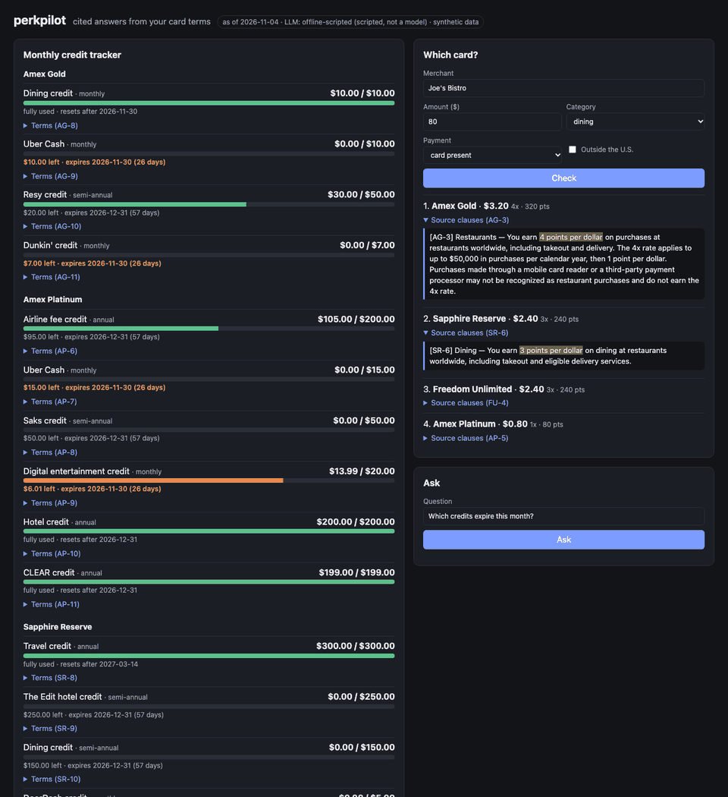
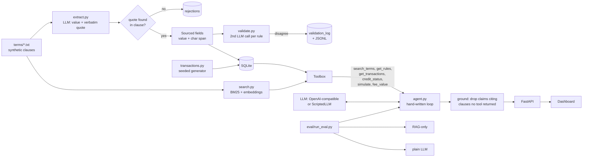

# perkpilot

An agent that reads credit-card benefit terms, turns them into structured rules where **every field
carries the character span it came from**, and answers questions like *"which card for this
purchase?"*, *"which credits expire soon?"* and *"is the annual fee worth it?"*, citing the exact
clause behind each claim.



> The GIF is five headless-Chrome screenshots of the real running UI stitched together (via URL
> parameters that pre-fill the forms), not a screen recording. A full-size still is in
> [docs/dashboard.png](docs/dashboard.png).

**Everything here is synthetic.** The card terms in [`perkpilot/terms/`](perkpilot/terms) are
short, clearly labelled paraphrases written for this project (not issuer documents; numbers may not
match the real cards), and the transactions come from a seeded generator for one fictional
cardholder. Not financial advice.

## Quick start

```bash
python -m venv .venv && . .venv/bin/activate
make install        # pip install -e ".[dev]"
make build          # extract + validate all 4 cards, generate transactions -> data/perkpilot.sqlite
make test           # unit tests (no API key needed)
make eval           # writes eval/results.md
make serve          # http://localhost:8000
python -m perkpilot ask "Which card should I use for a \$80 dinner?"
python -m perkpilot review   # validator disagreements + rejected fields
```

### LLM configuration

Any OpenAI-compatible `/chat/completions` endpoint works:

| Variable | Default | Meaning |
|---|---|---|
| `PERKPILOT_LLM_API_KEY` (or `OPENAI_API_KEY`) | unset | If set, real-LLM mode |
| `PERKPILOT_LLM_BASE_URL` | `https://api.openai.com/v1` | Any compatible server (vLLM, Ollama, OpenRouter, ...) |
| `PERKPILOT_LLM_MODEL` | `gpt-4o-mini` | Model name |
| `PERKPILOT_LLM_MODE` | `offline` without a key | Force `offline` or `openai` |
| `PERKPILOT_EMBED_MODEL` | unset | Remote embeddings for search; otherwise a local hashed n-gram embedding |
| `PERKPILOT_AS_OF` | `2026-11-04` | "Today" (the synthetic data ends on this date) |
| `PERKPILOT_CPP_<CARD>` | `1.0` | Cents per point used for expected value (an assumption) |

Without a key everything runs in **offline mode**: `ScriptedLLM` implements the same `chat()`
interface with deterministic regex/keyword heuristics, so extraction, validation, the agent loop,
the UI, the tests and the eval all run with no network. It is a stand-in, not a model, and every
result it produces is labelled as such.

## Architecture



- **Schema** ([`schema.py`](perkpilot/schema.py)): `EarningRule` (category, multiplier, cap,
  exclusions, booking channel), `Credit` (name, amount, period, reset, eligible merchants,
  enrollment, exclusions) and `Fee` (annual fee, foreign transaction fee). Every field is
  `Sourced[T] = {value, span: {clause_id, start, end}}`. Every LLM output (extraction, validation,
  final answers) is parsed with Pydantic, with one repair retry.
- **Extraction** ([`extract.py`](perkpilot/extract.py)): one call per clause. The model returns a
  value plus a verbatim quote; the quote is located in the clause (exact, then
  case/whitespace-insensitive) to get absolute offsets. A field whose quote isn't found is
  **rejected and logged**; a rule missing a required field (category, multiplier, amount...) is
  dropped.
- **Validation** ([`validate.py`](perkpilot/validate.py)): a second call re-reads each rule against
  its clause. Disagreements are written to SQLite and `data/validation_disagreements.jsonl` and
  surfaced as `validator_flags` on the rule. They are **not** auto-corrected.
- **`simulate`** ([`engine.py`](perkpilot/engine.py)): a pure function. Category matching
  (including "travel" covering flights and hotels, and U.S.-only supermarkets), booking channel
  derived from the merchant, exclusions (payment method, merchant type such as warehouse clubs,
  category), annual caps with spend-to-date, foreign transaction fees and point valuation. It ranks
  cards by expected value and cites the spans used.
- **Agent** ([`agent.py`](perkpilot/agent.py)): a plain loop (model, tool calls, tool results, ...,
  final JSON), with no framework. After the loop, `ground()` keeps only citations to clauses that a
  tool actually returned in this run. Claims left with no valid citation are dropped, and an answer
  with no grounded claims becomes "I don't know".
- **Search** ([`search.py`](perkpilot/search.py)): BM25 and dense cosine scores, normalized and
  blended 50/50. Dense uses remote embeddings if configured, otherwise a hashed word and character
  trigram embedding that needs no download.

## Eval results

From `make eval` ([full report](eval/results.md)). **These numbers come from the offline scripted
LLM**: hand-written heuristics standing in for all three setups, run over terms, heuristics and a
gold set written by the same author. They show that the pipeline works end to end and how the setups
differ in what information each can reach. They are *not* a measurement of any real LLM. No
real-LLM run was done for this README (no API key was available while building it).

| Metric (40 Q&A items, 10 unanswerable) | Plain LLM | RAG only | Full agent |
|---|---|---|---|
| Answer correctness (answerable) | 47% | 33% | 93% |
| Citation accuracy | 0% | 93% | 100% |
| Abstention rate on unanswerable | 0% | 90% | 100% |
| False abstention on answerable | 0% | 53% | 0% |
| Hallucination rate | 65% | 33% | 7% |

Extraction (60 field checks): precision 98%, recall 98%. The one miss is analysed below.

What the three setups are, in offline mode:
- **Plain LLM**: answers from a hand-written "memory" table that deliberately mixes correct and
  stale values (e.g. an older Sapphire Reserve fee). It never cites and never abstains.
- **RAG only**: top-6 hybrid-search clauses, then a naive reader. It has no transactions and no rule
  engine, so it abstains on credit and fee-value questions and ignores exclusions, channels and
  foreign transaction fees when picking a card.
- **Full agent**: the tool loop above.

## Failure analysis

1. **A negated sentence became a booking channel (the agent's only 2 wrong answers).** AP-4 says
   Platinum earns 5x on prepaid hotels through Amex Travel, then *"Hotel stays booked directly with
   the hotel earn 1 point per dollar."* The extractor attached `hotel_direct` to the 5x rule. The
   validator caught it (*"booking channel hotel_direct comes from a sentence with a different
   rate"*) and the flag is shown in answers and in `simulate` notes. Because disagreements are
   logged rather than auto-fixed, the engine still uses the bad rule: the agent recommends Platinum
   for a hotel booked directly with Marriott (truth: Sapphire Reserve, 4x) and says yes to "does
   Platinum earn 5x on hotels booked directly?". *Fix options:* block flagged fields from the engine
   until reviewed, or extract a separate rule per sentence.
2. **Facts the schema can't hold.** AP-7's Uber Cash is "$15 each month, plus an additional $20 in
   December". A single `amount` can't represent that, so December would be under-counted. The
   validator flags it (*"clause also mentions $20"*). Similarly, SR-8 says purchases reimbursed by
   the travel credit don't earn points; the engine doesn't model that, so Sapphire Reserve rewards
   are slightly overstated in the fee calculation.
3. **The offline heuristics are tuned to text written alongside them.** The regex extractor and the
   abstention threshold (60% of the question's content words must appear in the top clause) were
   developed against these terms and gold questions. Expect lower numbers on unseen wording; that
   is what the real-LLM mode is for.
4. **Gold answers that depend on data were frozen from this pipeline.** The expiring-credit,
   remaining-balance and fee-value answers were computed by the engine, then checked by hand (the
   credit arithmetic) before being frozen. A bug shared by the engine and that hand check would not
   be caught; the `simulate` unit tests cover the engine separately.
5. **RAG-only false abstentions** (53%) are by design in offline mode: it is told it has no
   transactions. A real LLM in that setup would more likely guess, which would raise its
   hallucination rate rather than its abstentions.

## Design decisions

- **Quotes, not offsets, from the LLM.** Models are bad at counting characters but good at copying
  text. Asking for a verbatim quote and locating it ourselves gives exact spans, and makes "no
  supporting span" a mechanical check.
- **Log, don't auto-fix, validator disagreements.** A second model disagreeing doesn't mean it is
  right. Flags reach the user and the review queue (`python -m perkpilot review`).
- **Deterministic math in tools.** Expected value, caps, credit windows and fee value are computed
  by pure code (`engine.py`, `credits.py`). The LLM decides *what* to compute and explains it.
- **Citations are checked against the run, not trusted.** A claim can only cite a clause that a
  tool returned during that run, which catches citations to clauses the model never looked at.
- **Fee value = credits actually used (at face value) + extra rewards vs. the no-fee Freedom
  Unlimited on the same purchases - annual fee**, over the trailing 365 days. Face value
  overstates credits most people would not otherwise buy; that caveat is part of every answer.
- **Pinned "today".** The synthetic data ends 2026-11-04 and `AS_OF` defaults to that, so the
  eval is reproducible on any date.

## Tests and CI

`make test` runs the `simulate` unit tests (caps, exclusions, booking channels, foreign fees,
purity), extraction and rejection tests, validator tests, agent and grounding tests (including a
fake model that cites a clause it never retrieved), and an API test. CI
([`.github/workflows/ci.yml`](.github/workflows/ci.yml)) runs the tests plus `make eval-smoke`
(every 4th Q&A item, offline) on each push.

## Layout

```
perkpilot/  terms/ schema.py extract.py validate.py engine.py credits.py search.py tools.py
            agent.py llm.py offline.py scripted.py transactions.py db.py build.py api.py static/
eval/       gold_extraction.json (60) gold_qa.json (40) run_eval.py results.md
tests/      test_simulate.py test_extract.py test_validate.py test_agent.py test_api.py
```
